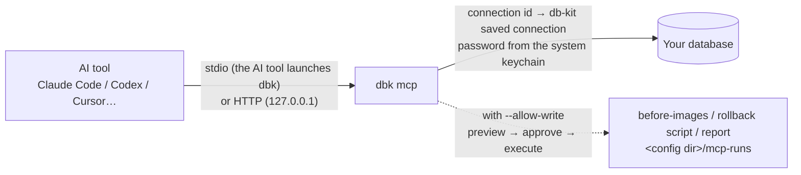
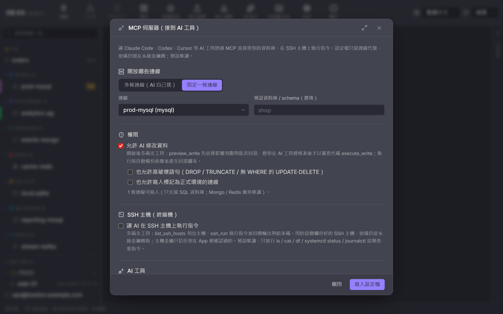
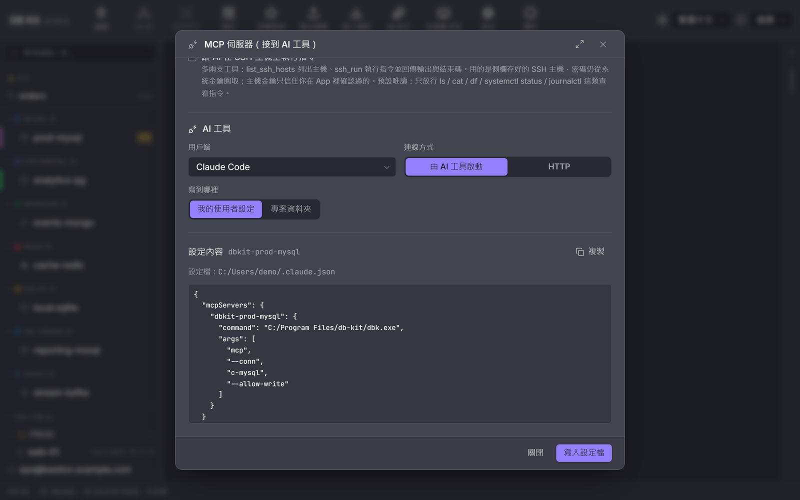
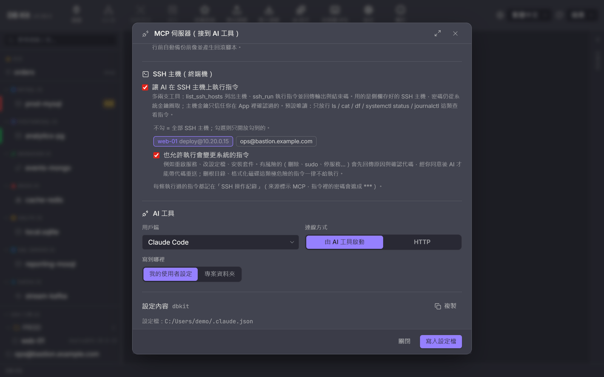

# MCP server: connect your databases to AI tools

[繁體中文](./mcp.md) · **English**

`dbk mcp` is a [Model Context Protocol](https://modelcontextprotocol.io) server. Once Claude Code, Codex, Cursor, VS Code (Copilot), Claude Desktop or Windsurf is connected to it, the AI can list tables, read columns, query data and look at execution plans on its own — using the connections you saved in db-kit, while passwords stay in the system keychain.

It is **read-only by default**. Letting the AI change data must be switched on explicitly when the server starts, and every change goes through Review & Run: the affected rows and rollback coverage are previewed first, it runs only after you approve in the AI tool, before-images are captured automatically and a rollback script is left behind.

You can also hand the **SSH hosts** saved in db-kit to the AI: let it check service status, read logs and look at disk usage, and — with the extra permission — restart services or edit configs for you. Read-only by default as well, and risky commands need your nod (see [SSH hosts (terminal)](#ssh-hosts-terminal)).

- [At a glance](#at-a-glance)
- [Set up in the app (fastest)](#set-up-in-the-app-fastest)
- [Set up from the command line](#set-up-from-the-command-line)
- [Single connection vs. multiple connections](#single-connection-vs-multiple-connections)
- [Tools](#tools)
- [Letting the AI change data](#letting-the-ai-change-data)
- [SSH hosts (terminal)](#ssh-hosts-terminal)
- [HTTP mode](#http-mode)
- [Config file locations](#config-file-locations)
- [Security model](#security-model)
- [FAQ](#faq)

## At a glance



| You want to… | Do this |
|---|---|
| Let an AI tool query one database | Right-click the connection → "Connect to AI tools (MCP)…" → "Write config" |
| Let the AI pick among several databases | Settings → "Set up MCP…" → "Several connections" |
| Let the AI change data (each change needs your approval) | Tick "Allow the AI to change data" |
| Let the AI check status / logs on SSH hosts | Tick "Let the AI run commands on SSH hosts" (read-only) |
| Let the AI restart services or edit configs | Also tick "Also allow commands that change the system" (risky ones need your consent) |
| Use it on a server / in CI | `dbk --conn shop mcp`, or `dbk mcp install --client claude-code --yes` |

## Set up in the app (fastest)

Both entry points open the same dialog:

- **Right-click a connection → "Connect to AI tools (MCP)…"**: that connection is preselected.
- **Settings → "MCP server" → "Set up MCP…"**: defaults to multiple connections.

<p align="center"></p>

Top to bottom, these are the decisions to make:

1. **Which connections**: one fixed connection (optionally with a default database / schema), or several and let the AI pick (nothing selected = all usable connections). Kafka / Elasticsearch / container connections are not supported by dbk and are skipped.
2. **Permissions**: read-only by default. With "Allow the AI to change data" ticked you can additionally allow destructive statements (DROP / TRUNCATE / UPDATE·DELETE without WHERE) and production connections. The dialog tells you how many connections are actually writable.
3. **SSH hosts (terminal)**: whether the AI may run commands on the SSH hosts saved in the sidebar, which hosts, and whether commands that change the system are allowed (see [SSH hosts (terminal)](#ssh-hosts-terminal)).
4. **AI tool and connection method**: pick the client; "Launched by the AI tool" (stdio, recommended) or "HTTP" (see [HTTP mode](#http-mode)). Clients with project-level configs can write into a project folder.
5. **Configuration**: the snippet and target file are previewed live. Copy and paste it yourself, or click "Write config" — the original file is backed up as `<file>.dbkit-bak`, only db-kit's own entry is changed, and everything else is kept as is.

<p align="center"></p>

Restart the AI tool afterwards. Entries already written are marked "Written", the button becomes "Update config", and "Remove from config" appears at the bottom left.

## Set up from the command line

`dbk mcp config` prints the snippet (writes nothing); `dbk mcp install` writes the config file:

```bash
# Print Cursor's config (multiple connections, read-only)
dbk mcp config --client cursor

# Add the "shop" connection to Claude Code's user config, with writes allowed
dbk --conn shop -d shop mcp install --client claude-code --allow-write          # without --yes: only prints what would be written
dbk --conn shop -d shop mcp install --client claude-code --allow-write --yes    # actually write it (the original is backed up)

# Write into a project folder (.mcp.json / .cursor/mcp.json / .vscode/mcp.json / .codex/config.toml)
dbk mcp install --client vscode --project . --yes
```

`--client`: `claude-code`, `codex`, `cursor`, `vscode`, `claude-desktop`, `windsurf`, `json` (generic `mcpServers` snippet). Server options (`--connections`, `--tools`, `--allow-*`, `--out`) are carried into the config as given; `--name` sets the server name (default `dbkit`, or `dbkit-<connection name>` for a single connection); `--bin` points at a specific dbk; `--http-url` targets an already running HTTP server instead.

Config files **never contain credentials**: only `--conn <name>` pointing at a saved connection is accepted (the config stores the connection id, so renaming does not break it); ad-hoc `--url` / `--kind` connections are refused.

Adding it by hand works too:

```bash
claude mcp add --scope user dbkit -- dbk mcp
codex mcp add dbkit -- dbk mcp
```

## Single connection vs. multiple connections

| | Single connection | Multiple connections |
|---|---|---|
| Start | `dbk --conn shop [-d shop] mcp` (or an ad-hoc `--url` / `--kind`) | `dbk mcp [--connections a,b]` |
| Tool arguments | No connection needed; `database` defaults to `-d` | Every tool takes `connection` (the connection name); the AI calls `list_connections` first |
| Good for | Projects with one database, CI | Day-to-day use, cross-database comparisons |

Multi-connection mode lists connections from the config file only and **connects on first use**, reusing the connection afterwards; `--connections` is an allow-list (names or ids). `list_connections` marks production and writable connections.

For PostgreSQL the tools' `database` argument is the **schema** (consistent with db-kit's sidebar). The database configured on the connection is "which database to connect to" and is never used as a schema — without `-d` the AI calls `list_databases` first.

## Tools

| Tool | Purpose | Available |
|---|---|---|
| `list_connections` | List usable connections (name / kind / host / default database / production / writable) | Multi-connection mode |
| `list_databases` | List databases / schemas | Always |
| `list_tables` | List tables (and views) | Always |
| `describe_table` | Columns, indexes, foreign keys | Always |
| `sample_rows` | First few rows (max 20) | Always |
| `run_query` | Read-only query (max 200 rows / 8 KB / 30 s); JSON for Mongo, a command line for Redis | Always |
| `explain_query` | Execution plan | SQL, Mongo |
| `list_routines` | Stored procedures / functions / triggers | SQL |
| `get_ddl` | CREATE statement of a table / view, definition of a procedure / function / trigger | SQL |
| `compare_schema` | Structural diff of two databases (across connections too), optionally with sync DDL — **generated, never executed** | SQL |
| `preview_write` | Preview a write: affected rows, rollback coverage and risks per statement; returns a review token | `--allow-write` |
| `execute_write` | Run the previewed SQL by its review token | `--allow-write` |
| `list_ssh_hosts` | List the available SSH hosts (name / user@host:port / folder / jump host) | `--ssh` |
| `ssh_run` | Run a command on an SSH host and return stdout / stderr / exit code (about 16 KB from the start and end, 30-second default timeout) | `--ssh` |

`--tools a,b` exposes only the listed tools (calls to anything else are rejected).

## Letting the AI change data

```bash
dbk --conn shop -d shop mcp --allow-write
```

Changing data always takes two steps:

1. **`preview_write`** (`sql` may contain several statements): the Review & Run engine analyzes each statement — how many rows, whether it can be fully rolled back, UPDATEs without WHERE. This step **does not touch any data**. On success it returns a 12-character review token.
2. **`execute_write`** (takes only the review token): runs **the SQL kept on the server** — the model cannot preview one script and execute another. Before-images and after-images are captured; it returns rows affected per statement, a diff summary and the start of the rollback script. The full before-images, `rollback.sql` and report go to `--out` (default `<config dir>/mcp-runs/`).

AI tools ask you to approve every tool call, so you will see two prompts: one for the preview, one for the execution. If you disagree with the preview, reject the second one.

Server flags are **hard limits** the model cannot change:

| Case | Requires |
|---|---|
| Regular writes (UPDATE / DELETE with WHERE, INSERT, reversible DDL) | `--allow-write` |
| DROP / TRUNCATE / UPDATE·DELETE without WHERE | also `--allow-destructive` |
| Connections marked as production | also `--allow-prod` |
| Statements that cannot be fully rolled back (e.g. more affected rows than the before-image capture limit, DDL without a reverse statement) | The model passes `acknowledge_incomplete: true` to `execute_write` — the tool description tells it to get your consent first, and the argument is visible in the approval prompt |

Review tokens expire after 15 minutes and are single use. Only SQL databases are supported (MySQL / MariaDB / PostgreSQL / SQL Server / Oracle / SQLite); Mongo / Redis stay read-only. `run_query` still rejects write statements and points the model to `preview_write`.

## SSH hosts (terminal)

```bash
dbk mcp --ssh                                # expose every SSH host, read-only
dbk mcp --ssh-hosts web1,web2                # only these two (implies --ssh)
dbk mcp --ssh --allow-ssh-exec               # allow commands that change the system
```

In the app: in the MCP dialog's "SSH hosts (terminal)" section tick "Let the AI run commands on SSH hosts", then optionally pick hosts and tick "Also allow commands that change the system". Databases and SSH can live in the same server, or you can keep just one of them (`--tools list_ssh_hosts,ssh_run` leaves only the SSH tools).

<p align="center"></p>

It uses the sidebar's "SSH hosts" list (FTP hosts have no terminal and are not listed): user, private key and jump hosts follow the host settings, passwords / key passphrases come from the system keychain, and the config file contains only flags, never credentials. `ssh_run` uses SSH's exec channel (no PTY): one command per call, interpreted by the remote login shell, so `&&` `|` `;` work; stdin is empty.

**Two modes; the flags are hard limits:**

| Mode | What can run |
|---|---|
| `--ssh` (read-only) | Inspection commands only: `ls`, `cat`, `grep`, `df`, `free`, `ps`, `ss`, `ip a`, `systemctl status`, `journalctl`, `docker ps / logs`, `kubectl get / describe / logs`, `git status / log / diff`, `curl` GETs… Anything not on the list, redirects that write files (`> file`), `sudo`, and options that write or run other programs (`find -exec`, `sed -i`, `curl -o`, `git -c`) are rejected |
| `--allow-ssh-exec` | Classified with the same safety rules as the app's terminal (the very rules behind the "AI suggested command" confirmation): ordinary commands run directly; **risky** ones (deleting, `sudo`, stopping / restarting services, writing system directories, `curl \| sh`, removing packages…) are not run yet — the reasons and a 12-character confirmation token come back; **extremely dangerous** ones (`rm -rf /`, formatting disks, writing to disk devices, fork bombs) are never run |

Risky commands take two steps, in the same spirit as database writes:

1. The AI calls `ssh_run`, gets held back, and receives reasons such as "stops, restarts or disables a service" plus a token. The tool description tells it to show you the command and the reasons and get your consent.
2. After you agree, the AI calls again with the **same host and the same command** plus `confirm_token`. The token is bound to the host and the command (change one character and a new token is needed), expires after 15 minutes and is single use, so the model cannot confirm one command and run another.

Together with the AI tool's own approval prompt for every tool call, you see a risky command twice.

**Other rules:**

- **Only host keys you have confirmed are trusted**: the AI never trusts a new host for you. Before first use, open a terminal to that host in db-kit once and confirm the fingerprint (same known_hosts). A changed fingerprint is always refused.
- **Logins that need live input don't work**: one-time password / keyboard-interactive hosts and hosts without a saved password have nobody to ask over MCP; the error asks you to save the password or use a private key / ssh-agent.
- **Interactive commands are rejected up front**: `vim`, `top`, `less`, `tail -f`, `mysql` without `-e` stop and wait for typing, and there is no screen. The error teaches the model a non-interactive form (`top -b -n 1`, `tail -n 100`, `journalctl --no-pager`). `sudo` without NOPASSWD fails at once because it cannot read a password, so nothing hangs.
- **Timeouts and output limits**: `timeout_secs` defaults to 30 and caps at 300 seconds; on timeout SIGKILL is sent and the result says the remote process may still be running. stdout keeps the first 4 KB + last 12 KB, stderr the first 2 KB + last 4 KB (the interesting part of a log is usually at the end).
- **Connection reuse**: a host is connected on its first call and reused afterwards; a dropped connection is retried once.
- **Everything is logged**: every command that actually runs is written to the "SSH activity log" (source MCP, with host and exit code; password arguments in the command are masked as `***`), searchable in the app by host / time / keyword.

## HTTP mode

With stdio the AI tool launches dbk as a child process — the simplest setup. When several tools should share one server, or a tool only supports remote MCP, use HTTP (MCP Streamable HTTP):

```bash
DBKIT_MCP_TOKEN=<long random string> dbk mcp --http 127.0.0.1:8765
# clients connect to http://127.0.0.1:8765/mcp with Authorization: Bearer <token>
```

In the app: choose "HTTP" in the MCP dialog → "Start in background". The app generates and keeps a token (in `<config dir>/mcp-http.json`; it is handed to dbk through an environment variable and never appears on the process command line), and the server stops when db-kit closes. Changing connection / permission options while it runs shows "Apply options and restart"; after "Regenerate token", HTTP configs already written to AI tools must be written again.

- The token is optional on loopback; **listening on a non-loopback address (e.g. `0.0.0.0`) without a token refuses to start**.
- Requests carrying an `Origin` header are accepted only from `localhost` / `127.0.0.1` / `[::1]`, and no CORS headers are sent: web pages (including DNS rebinding to 127.0.0.1) cannot get in.
- Each `initialize` gets an `Mcp-Session-Id`; `GET` returns 405 (no server-push stream), `DELETE` ends the session. Clients that only accept SSE get the response as a single SSE event.
- Codex reads the token from the `DBKIT_MCP_TOKEN` environment variable (`bearer_token_env_var`), so the token is not written to `config.toml`; other clients' configs contain the `Authorization` header directly — **do not commit that file**. Claude Desktop's config only accepts stdio.

## Config file locations

| Client | User level | Project level (`--project`) | Format |
|---|---|---|---|
| Claude Code | `~/.claude.json` | `.mcp.json` | `mcpServers` (`type: stdio / http`) |
| Codex | `~/.codex/config.toml` (or `$CODEX_HOME`) | `.codex/config.toml` | `[mcp_servers.<name>]` |
| Cursor | `~/.cursor/mcp.json` | `.cursor/mcp.json` | `mcpServers` |
| VS Code | `<config dir>/Code/User/mcp.json` | `.vscode/mcp.json` | `servers` (`type: stdio / http`) |
| Claude Desktop | `<config dir>/Claude/claude_desktop_config.json` | — | `mcpServers` (stdio only) |
| Windsurf | `~/.codeium/windsurf/mcp_config.json` | — | `mcpServers` (`serverUrl` for HTTP) |

`<config dir>`: `%APPDATA%` on Windows, `~/Library/Application Support` on macOS, `~/.config` on Linux.

Write rules: only `mcpServers.<name>` is touched (for Codex, `[mcp_servers.<name>]` and its sub-tables); everything else, including key order, is kept. The file is backed up as `.dbkit-bak` first and then replaced atomically (temp file + rename). Files containing comments or trailing commas (allowed in VS Code's `mcp.json`) are **not** rewritten — you are asked to paste the snippet manually.

## Security model

- **No passwords in config files**: connections are referenced by id and credentials come from the system keychain at run time (the same store the GUI uses).
- **Read-only by default**: SQL goes through the strict variant of the `dbk query` guard — even `EXPLAIN ANALYZE DELETE …` is blocked (PostgreSQL really runs the inner statement); MongoDB rejects `$out` / `$merge`; Redis allows read commands only. **One statement per call.**
- **Writes are two-step, bound to the SQL, and capped by server flags** (see above); every write leaves before-images and a rollback script.
- **Guards run before connecting**: write statements and forbidden connections fail before any connection is dialed, so the model never mistakes "not allowed" for "unreachable" and keeps retrying.
- **Tool failures are `isError` results**, not protocol errors, so the model sees the reason and can correct itself.
- **Bounded output**: row / byte / timeout limits keep a wide table from pushing the whole conversation out of context.
- **HTTP**: loopback by default, token required otherwise, Origin check, no CORS.
- **SSH hosts**: off by default; `--ssh` is a read-only allowlist, only `--allow-ssh-exec` can change the system, risky commands need your consent (the token is bound to the command) and extremely dangerous ones never run; only confirmed host keys are trusted; every command goes into the activity log. The command classification and the app terminal's confirmation share one set of test cases (`src-tauri/tests/fixtures/shell-guard-cases.json`), so the two cannot drift apart.

The app's built-in AI assistant (the right-hand panel) uses `dbk mcp` as well, but always with a single read-only connection; it is not affected by these settings.

## FAQ

**The AI tool says the tools are missing / the server failed to start.** Run the command from the config in a terminal first (e.g. `dbk mcp`): it should print "MCP server started (stdio)" and wait for input (Ctrl+C to quit). If dbk is not found, pass its full path with `--bin`, or set `DB_KIT_DBK_BIN` for the app.

**`codex exec` fails a tool call saying approval is required.** Codex's non-interactive mode (`codex exec`) has no approval prompt, so MCP tool calls are rejected; interactive `codex` asks and you can allow it. For Claude Code's `claude -p`, pre-approve tools with `--allowedTools mcp__dbkit__<tool>`.

**Which clients were tested end to end?** Claude Code (`claude -p` listed tables, counted rows and read DDL over MCP, matching the database) and Codex (handshake, tool listing and calls work; non-interactive mode is subject to the approval limit above). Other clients were verified for config-file format only.

**`list_connections` is empty.** Multi-connection mode lists only kinds dbk supports (no Kafka / Elasticsearch / RabbitMQ / container connections) and honors the `--connections` allow-list. `dbk conn list` shows every saved connection.

**`execute_write` keeps asking for `acknowledge_incomplete`.** The preview found statements that cannot be fully rolled back (e.g. before-images over the capture limit, or DDL with no reverse statement). If that is acceptable, tell the AI "I agree, go ahead".

**`ssh_run` says the host key has not been trusted yet.** MCP does not accept new host fingerprints for you. Open a terminal to the host from the db-kit sidebar once, check the fingerprint and click "Accept and save" ("This time only" is not remembered), then let the AI try again.

**`ssh_run` says read-only mode does not allow it.** The server was started with `--ssh` (read-only). If you really want the AI to change the system, tick "Also allow commands that change the system" (`--allow-ssh-exec`) in the MCP dialog, write the config again / restart the HTTP server, and restart the AI tool.

**Sharing with the team.** A single-connection config stores the **connection id**, which only exists on your machine. For a shared project-level config use multi-connection mode (`dbk mcp`, not bound to an id), or change `--conn` to a connection name by hand and have everyone create a connection with that name. Do **not** enable writes in project-level configs; enable them per person at the user level.
